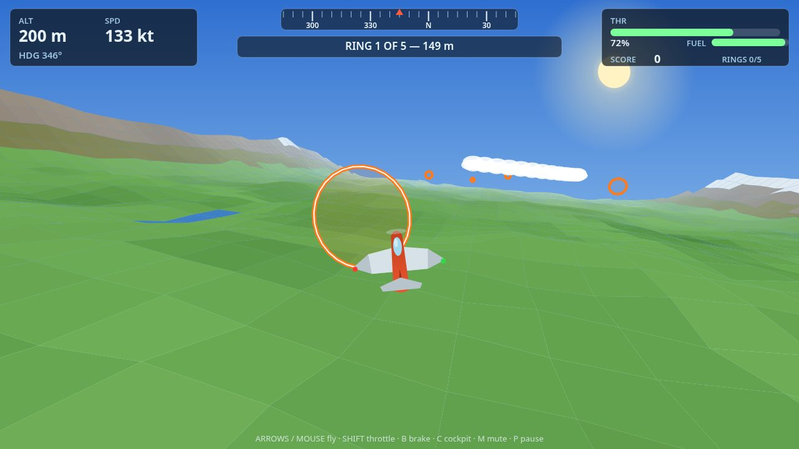

# Meridian Run — a valley flight game

[](https://make.fun/bounty/best-flight-game-20261126-0057?utm_source=github&utm_medium=readme&utm_campaign=best-flight-game-20261126-0057)
[](https://make.fun/bounty/best-flight-game-20261126-0057/leaderboard?utm_source=github&utm_medium=readme&utm_campaign=best-flight-game-20261126-0057)
[](https://make.fun/bounty/best-flight-game-20261126-0057?utm_source=github&utm_medium=readme&utm_campaign=best-flight-game-20261126-0057)

make.fun bounty: https://make.fun/bounty/best-flight-game-20261126-0057



## The game

**Meridian Run** is an original flight game, drawn entirely in code on one
canvas — no images, no libraries, no network. You fly a little red prop plane
out of a home valley: take off from the grass strip, thread five glowing rings
strung along the river valley, then come home and land before the fuel runs out.

- **Two cameras**: chase view behind the plane, or a full cockpit with a
  six-pack of lit instruments — attitude, airspeed, altimeter, compass, fuel
  and throttle (press `C`).
- **Real flying**: throttle, pitch and banked turns; the wings level when you
  let go, the nose drops when you fly too slow, and a hard or banked touchdown
  is a crash.
- **Missions with decisions**: fuel burns with throttle, so a flat-out dash to
  the rings can leave you gliding home; a dead-centre ring pass pays extra.
- **Controls**: arrow keys or the mouse steer, `Shift`/`Ctrl` or the mouse
  wheel work the throttle, `B` is the airbrake for landing, `C` swaps the
  camera, `M` mutes the sound, `P` pauses, `R` flies again.

## How it is built

- `game/index.html` — the page; `game/src/` holds the game in one file per job:
  `config.js` (world and physics), `random.js` (seeded noise), `terrain.js`
  (the valley heightfield), `aircraft.js` (flight physics and landings),
  `missions.js` (takeoff, rings, landing, scoring), `hud.js` (HUD and gauges),
  `input.js` (keyboard and mouse), `render.js` (sky, terrain, rings, plane),
  `audio.js` (synthesised engine and chimes), `shots.js` (screenshot scenes),
  `main.js` (the loop and the screens).
- `main.ts` (Node 22, standard library only) copies `game/` and `screenshots/`
  to `/output` and writes `/output/dossier.json` with the kit's
  `vendor/makefun-game.ts`, unchanged.
- `screenshots/` holds four real renders of the game running in a browser.

## Play it

Serve `game/` with any static server and open `index.html` in desktop Chrome,
for example:

```
cd game && python3 -m http.server 8080
```

Then open http://localhost:8080 — no build step, no network requests.
